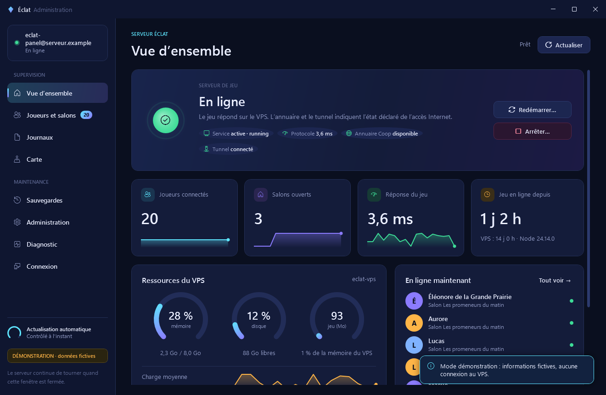
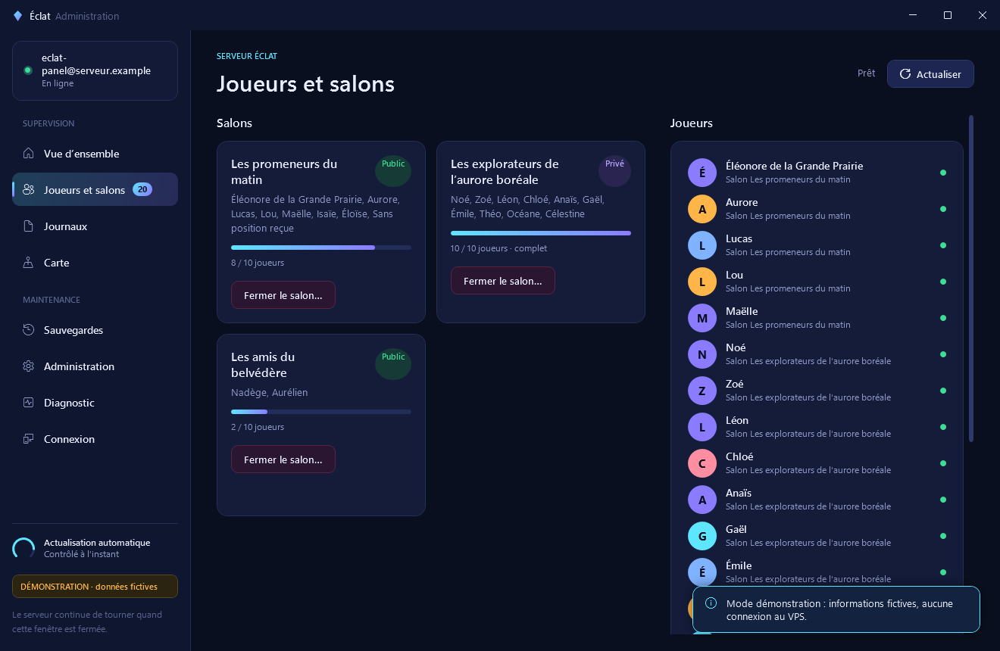
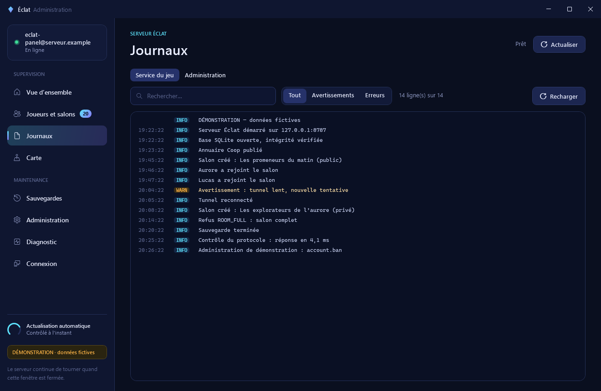
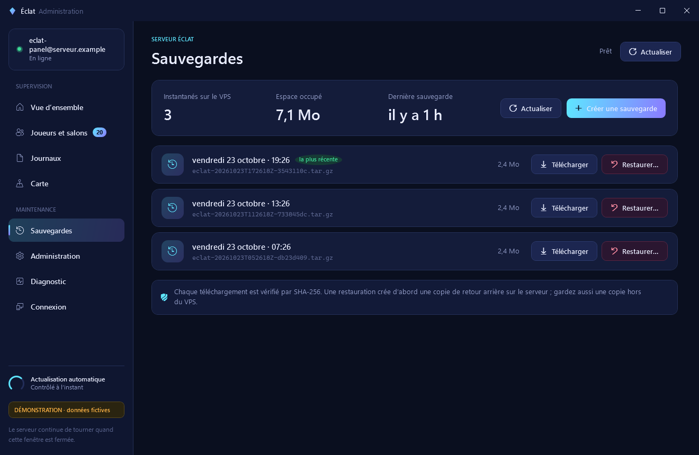
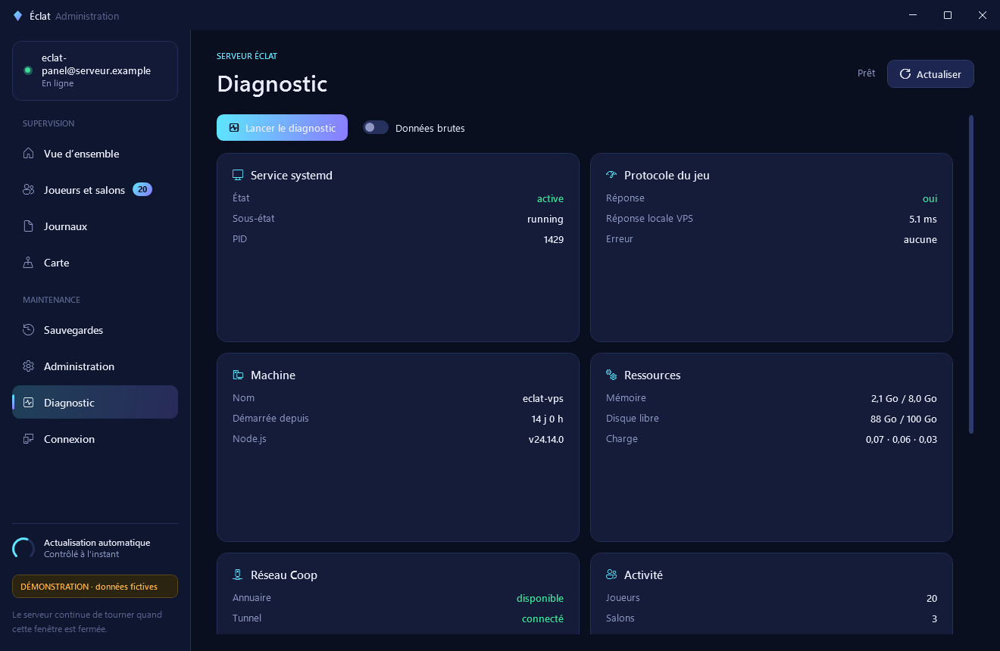
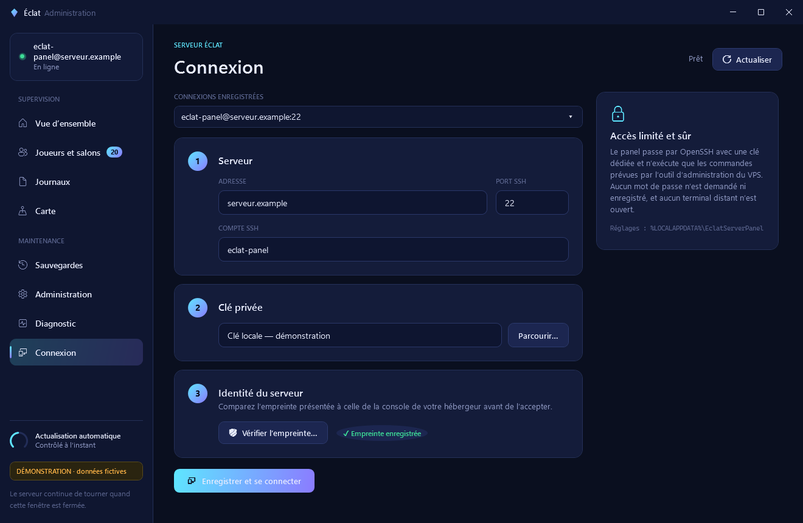
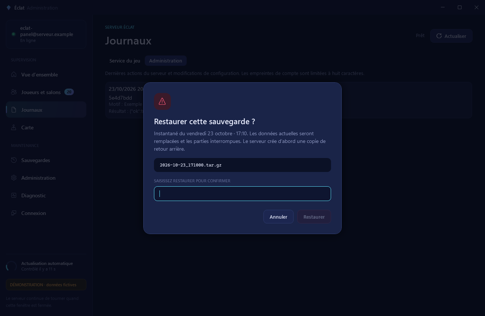

# Éclat Server Panel

Application Windows pour administrer un serveur de jeu Éclat à distance : voir s’il répond, consulter les journaux, le relancer et conserver des sauvegardes de sa base SQLite.

Le panel passe par OpenSSH et une clé privée conservée sur votre PC. Le serveur continue de tourner lorsque l’application est fermée. Aucun port d’administration Web supplémentaire n’est nécessaire.

**La version 1.2.0 réunit la carte, les commandes d’administration et les corrections des contrôles du panel.** La carte et les commandes demandent aussi le [serveur compatible de la PR 36](https://github.com/Nagaraaa/pokemon-eclat-originel/pull/36) et l’outil Linux correspondant. Installer l’application Windows ne les installe pas sur le VPS. La validation de cette version utilise des serveurs locaux temporaires ; aucun VPS n’a été contacté ou modifié pour cette intégration.



*Aperçu avec des données fictives.*

L’interface sombre présente l’état du jeu, ses ressources, ses joueurs et ses salons. Les actions sensibles se confirment dans la fenêtre ; les résultats et les erreurs restent visibles dans le panel.

| Joueurs et salons | Journaux | Sauvegardes |
| --- | --- | --- |
|  |  |  |
| **Diagnostic** | **Connexion** | **Confirmation** |
|  |  |  |

| Carte et tableau | Groupe de cinq joueurs | Groupe de douze joueurs |
| --- | --- | --- |
|  |  |  |

| Commandes d’administration | Confirmation par saisie |
| --- | --- |
|  |  |

*Toutes les captures utilisent des données de démonstration.*

## Fonctions

| Action | Fonctionnement |
| --- | --- |
| Vérifier l’état | État du service et échange `hello` / `ping` avec le jeu. Un processus actif ne suffit pas à déclarer le jeu disponible. |
| Voir l’activité | Joueurs et salons remontés par le serveur, avec la capacité de chaque salon, jusqu’à dix joueurs. Une activité absente ou ancienne est indiquée comme non confirmée. |
| Fermer un salon | Confirmation, sortie des membres et suppression du salon, sans fermer les autres salons. Les deux boutons de fermeture utilisent le même canal d’administration du serveur. |
| Contrôler le service | Démarrer, arrêter ou redémarrer le service du jeu. |
| Lire les journaux | Dernières lignes du service, avec masquage des valeurs sensibles reconnues. |
| Suivre les ressources | Mémoire, charge et espace disque du VPS. |
| Sauvegarder | Créer un instantané SQLite cohérent et en télécharger une copie vérifiée par SHA-256. |
| Restaurer | Choisir une sauvegarde, confirmer la restauration et conserver une copie de la base précédente. |

La version 1.2.0 comprend aussi :

- une carte schématique avec regroupement des joueurs, positions anciennes estompées et liste en tableau, fiches ou par lieu ;
- l’expulsion, le bannissement et sa levée, la fermeture ou la modification d’un salon et le mode maintenance ;
- les corrections de solde Éclats et les remboursements de jetons, avec motif et journal ;
- l’édition des évènements, bannières et prix, la confirmation du rechargement par le jeu et vingt versions de configuration ;
- les statistiques en lecture seule : Éclats en circulation, tirages, chromatiques, casino et activité quotidienne des comptes.

Le [guide carte et commandes](docs/carte-commandes.md) détaille les confirmations, les données visibles et les limites. Les lieux et leurs coordonnées viennent du serveur ; le panel dessine ses propres formes et n’embarque pas de carte extraite du jeu.

Le dépôt contient le panel et son outil d’administration Linux. Il ne contient ni ROM, ni sprites, ni code du serveur de jeu, ni données de joueurs. La distribution du serveur se fournit séparément.

L’état est contrôlé toutes les vingt secondes, quelle que soit la page ouverte. Les courbes conservent les dernières mesures de la session ; elles repartent de zéro si la connexion change. Les journaux se chargent à l’ouverture de leur page ou sur actualisation.

La latence affichée mesure l’échange de contrôle effectué **localement sur le VPS**. Elle ne représente pas le ping des joueurs. L’annuaire et le tunnel reflètent leur dernier état déclaré par le serveur.

Les commandes sont exécutées l’une après l’autre, y compris pendant une confirmation. Après un démarrage, un arrêt, un redémarrage ou une restauration, le panel relit l’état du serveur. Une commande qui expire n’est jamais répétée automatiquement : le résultat peut être incertain et doit être contrôlé avant une nouvelle tentative.

## Prérequis

**Sur le PC :** Windows 10 ou 11 en 64 bits, avec le client OpenSSH Windows (`ssh`, `ssh-keyscan`, `ssh-keygen`). Une compilation autonome inclut le runtime .NET.

**Sur le VPS :** Debian avec systemd, Python 3, SQLite et Node.js **24.14 ou plus récent dans la branche 24** pour la distribution du jeu prévue ici. L’installation initiale demande un accès administrateur. L’application utilise ensuite un compte SSH dédié.

Le panel est conçu pour un serveur Éclat compatible avec l’outil Linux de ce dépôt. Il ne détecte pas automatiquement les commandes de n’importe quel serveur Pokémon.

## Télécharger

Prendre l’archive Windows 1.2.0 dans les [versions publiées](https://github.com/Nagaraaa/EclatServerPanel/releases/latest), la décompresser puis ouvrir `EclatServerPanel.exe`. Le runtime .NET est inclus. Le fichier `SHA256SUMS.txt` de la version permet de vérifier l’archive. Le [guide de déploiement](docs/deploiement.md) décrit les éléments à installer séparément sur un serveur compatible.

## Première connexion

1. Préparer le VPS en suivant le [guide de déploiement](docs/deploiement.md).
2. Ouvrir le panel et renseigner l’hôte, le port SSH, le compte dédié et le chemin de la clé privée.
3. Afficher l’empreinte du serveur. La comparer à l’empreinte obtenue dans la console du fournisseur avant de l’accepter.
4. Tester la connexion et consulter l’état du jeu.

La liste **Connexions enregistrées** permet de sélectionner un accès mémorisé. **Enregistrer et se connecter** conserve aussi les autres profils. L’ancienne connexion est reprise automatiquement. Les profils sont dans `%LOCALAPPDATA%\EclatServerPanel\connections.json`.

Le sélecteur conserve le thème sombre. L’ancien fichier `connection.json` et les empreintes SSH restent utilisables ; une mise à jour du panel ne demande pas de recréer les clés. Changer de profil efface les données affichées pour l’ancien hôte avant un nouveau contrôle.

Les réglages sont enregistrés dans `%LOCALAPPDATA%\EclatServerPanel\connection.json`. Ils contiennent l’adresse du serveur et le chemin de la clé, jamais son contenu. Les clés d’hôte acceptées sont conservées dans un fichier `known_hosts` du même dossier. Aucun mot de passe root n’est demandé ou enregistré par le panel.

Les connexions sont non interactives. Si la clé possède une phrase secrète, la charger préalablement dans l’agent OpenSSH de Windows avec `ssh-add` ; l’application n’affiche pas de demande de phrase secrète.

Une empreinte obtenue par `ssh-keyscan` doit être vérifiée par un autre moyen : elle ne prouve pas, à elle seule, l’identité du VPS. Les connexions suivantes exigent la même clé d’hôte.

## Compiler

Installer le SDK .NET 8, puis depuis la racine du dépôt :

```powershell
dotnet build src/EclatServerPanel/EclatServerPanel.csproj -c Release
dotnet publish src/EclatServerPanel/EclatServerPanel.csproj -c Release -r win-x64 --self-contained true -o dist/win-x64
```

Lancer `dist\win-x64\EclatServerPanel.exe`. Le dossier produit est portable ; les préférences restent dans le profil Windows.

Pour voir l’interface sans se connecter à un serveur :

```powershell
.\dist\win-x64\EclatServerPanel.exe --demo
```

Le mode démo utilise des données fictives et ne permet pas de piloter le VPS. Il fournit vingt joueurs, des groupes de cinq et douze personnes, des positions anciennes, un compte banni et un évènement actif. Les commandes y modifient seulement les données simulées.

`--capture-demo-pages DOSSIER` enregistre chaque page, les trois présentations de la liste, les groupes ouverts, les écrans d’administration et leurs confirmations.

## Exploitation

- Une sauvegarde SQLite couvre les données de la base. Elle ne remplace pas une copie de la configuration et de la distribution privée du jeu.
- Une image automatique de l’hébergeur facilite la reprise du VPS ; elle ne remplace pas les sauvegardes cohérentes de SQLite.
- Garder une copie des sauvegardes hors du VPS, par exemple sur le PC.
- Une restauration remplace les données actuelles par celles de la sauvegarde choisie. Les modifications postérieures ne sont pas fusionnées.
- Le téléchargement et la restauration via le panel sont limités aux bases de 64 Mio. Le téléchargement exporte uniquement la base SQLite ; les fichiers de configuration privés restent sur le VPS.
- L’accès SSH du panel est limité à des commandes prévues dans l’outil d’administration. Il ne fournit pas de terminal distant.

Le [guide de migration](docs/migration.md) décrit la bascule depuis un ancien hôte. Les [notes de sécurité](docs/securite.md) précisent les accès et les limites du masquage des journaux.

Les nouvelles commandes passent par une socket locale privée sur le VPS. Les corrections d’économie sont exécutées et journalisées par le serveur. Le [guide des actions Linux](docs/administration-linux.md) décrit les échanges, la validation des arguments et les contrôles de configuration.

## Validation

Le dépôt prévoit une compilation Windows et des vérifications automatisées dans [GitHub Actions](.github/workflows/build.yml). Les tests du panel couvrent les réponses invalides, les empreintes SSH, l’intégrité des téléchargements et les parcours de l’interface : navigation pendant un contrôle, confirmations, changement d’hôte, carte, tri et filtres conservés, configuration et journal masqué.

Les tests Linux vérifient les commandes, les sauvegardes SQLite, les restaurations et les écritures de configuration dans des dossiers temporaires. Deux essais supplémentaires peuvent lancer le vrai serveur de développement et son validateur, sur une nouvelle base locale. Ils sont ignorés lorsque cette distribution séparée n’est pas fournie ; leur lancement est décrit dans [les actions Linux](docs/administration-linux.md). Ces essais ne mesurent pas la disponibilité d’un VPS ou une partie jouée entre deux PC.

Vérifications du panel sous Windows :

```powershell
dotnet run --project src/EclatServerPanel/EclatServerPanel.csproj -c Release -- --self-test
```

Vérifications de l’outil d’administration sous Linux, avec Python 3 :

```sh
python -m unittest discover -s tests -v
```

Après toute installation, vérifier séparément l’accès SSH, les réponses du jeu, une sauvegarde téléchargeable et une connexion depuis un client réel. Tester une restauration sur une base de test avant de s’en servir sur des données importantes.

## Licence

Code sous [licence MIT](LICENSE). Les noms de jeux et marques mentionnés restent la propriété de leurs détenteurs. Ce projet ne distribue aucun contenu Nintendo et n’est pas affilié à Nintendo, Game Freak ou The Pokémon Company.

## Intégration de la version 1.2.0

Les corrections de `codex/admin-controls-isolated` (`e29d0ee`) sont réunies avec la carte et l’administration avancée dans cette version : profils SSH conservés, sélecteur sombre, présentation allégée et interrupteurs **Données brutes** réparés dans Sessions et Diagnostic. La fermeture depuis les salons et celle depuis Administration passent toutes deux par le canal unique du serveur compatible.

Les [preuves du contrôle isolé](docs/evidence/admin-controls/README.md) décrivent l’état testé avant la fusion. Elles restent un relevé historique ; les anciens chemins de branche et le canal limité qu’elles mentionnent ne sont pas une seconde installation à utiliser avec la 1.2.0. La [validation du panneau intégré](docs/carte-commandes.md#validation-de-la-version-120) précise les essais locaux et leurs limites. Les profils, clés et données de joueurs restent privés ; les captures publiées sont fictives.
