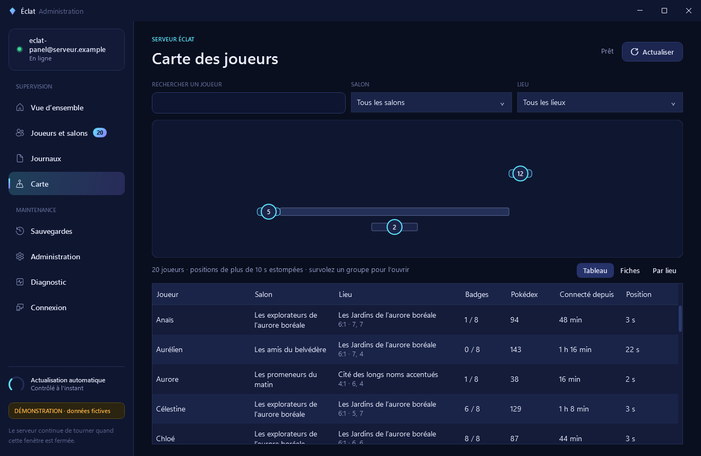
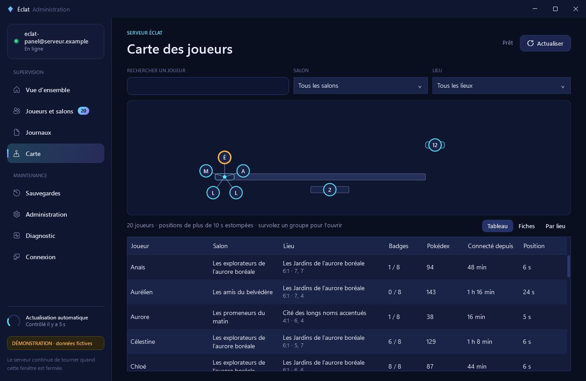
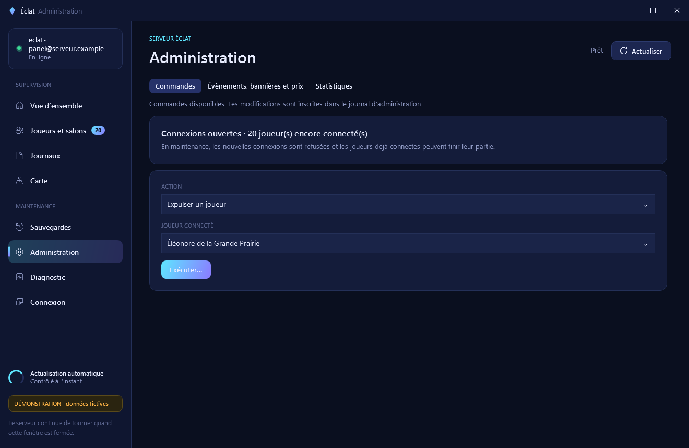

# Carte des joueurs et commandes d’administration

La version 1.2.0 rassemble la carte des joueurs, les commandes d’administration et les corrections des contrôles et des profils SSH. Ces fonctions demandent le [serveur compatible de la PR 36](https://github.com/Nagaraaa/pokemon-eclat-originel/pull/36) et l’outil Linux correspondant.

La validation décrite ici a été faite sur le PC et dans des serveurs locaux temporaires. Aucun VPS n’a été contacté ou modifié pour cette intégration. Installer l’application Windows ne met pas à jour le serveur de jeu ; l’installation des composants Linux reste une étape distincte.

## Lire la carte

La page Carte associe la région à la liste des joueurs. Les noms de lieux, les cartes et les coordonnées des zones viennent du serveur. Sans autre réglage, le panel dessine la région lui-même : terres, routes, villes et lieux. Un bâtiment est rattaché à la section de sa ville lorsque les données du serveur l’indiquent.

Une pastille représente un joueur, à la couleur de son salon ; elle pulse tant que sa position est récente. Lorsque plusieurs joueurs sont dans la même section, une pastille affiche leur nombre, entourée d’un anneau partagé entre leurs salons. Un groupe de deux à huit joueurs s’ouvre en éventail au survol ou au clic ; un groupe plus grand s’affiche dans le panneau de droite. Cliquer un joueur le sélectionne aussi dans la liste principale et affiche son détail à droite. Cliquer à côté referme le groupe.

### Carte du jeu

Le bouton **Afficher la carte du jeu…** lit la Carte de la Ville de Kanto dans votre ROM Rouge Feu d’origine, française ou anglaise, celle qu’accepte le lanceur du jeu. Le panel vérifie l’empreinte de la ROM puis celle de chaque élément lu (dessins, plan et couleurs). Il enregistre seulement l’image de la carte, 192 × 144 pixels, dans `%LOCALAPPDATA%\EclatServerPanel\town-map.png`. La ROM n’est ni copiée ni conservée, et aucune image du jeu n’est publiée dans ce dépôt. Les pastilles se placent sur la grille de la carte du jeu, celle de son curseur. Le sélecteur **Carte du jeu / Schéma** passe de l’une à l’autre ; supprimer le fichier retire la carte. La même lecture est possible sans fenêtre : `EclatServerPanel.exe --import-town-map chemin\vers\la-rom.gba`.

La démonstration garde le schéma, car sa région fictive ne correspond pas à la carte du jeu. Pour vérifier l’alignement en développement, la variable `ECLAT_PANEL_DEMO_ATLAS` peut désigner une copie locale de l’atlas d’un serveur ; les joueurs fictifs sont alors placés sur ses lieux. Les captures ainsi produites restent locales.

| Groupe de cinq joueurs | Groupe de douze joueurs |
| --- | --- |
|  |  |

*Données fictives. Un groupe sur la carte peut réunir des joueurs de plusieurs salons ; chaque salon reste limité à dix personnes.*

Les positions de plus de dix secondes sont estompées. Un joueur sans position apparaît dans la liste avec un lieu inconnu et n’ajoute pas de point à la carte. Une actualisation en échec retire les anciennes positions de la vue en cours et indique que l’activité n’est pas confirmée.

## Utiliser la liste

Trois présentations partagent la même recherche et les mêmes filtres : Tableau, Fiches et Par lieu. Le tableau permet de trier par colonne. La recherche accepte les noms accentués, y compris lorsqu’on saisit le nom sans ses accents.

Chaque joueur peut afficher son nom, son salon, son lieu, sa carte et ses coordonnées, ses badges, son Pokédex, la durée de sa connexion et l’âge de sa position. Les valeurs inconnues restent signalées. Sélectionner une ligne met en évidence le joueur sur la carte et ouvre son groupe.

Le panel actualise l’activité toutes les vingt secondes. La sélection, la recherche, les filtres, le tri et le défilement sont conservés lors d’une actualisation. Un changement de connexion efface les données de l’ancien serveur et ses cibles d’administration.

## Donner une commande

La page Administration charge les joueurs connectés, les comptes connus, les bannissements et les salons depuis le serveur. Choisir une action puis sa cible. Les commandes économiques et les bannissements exigent un motif de trois à 240 caractères.

| Action | Effet | Confirmation |
| --- | --- | --- |
| Expulser | Ferme la connexion du joueur avec un code reconnu du client. | Simple |
| Bannir | Refuse les connexions du compte pour une durée choisie ou sans limite. | Saisir le nom affiché du compte |
| Lever un bannissement | Autorise à nouveau les connexions du compte choisi. | Simple |
| Fermer un salon | Fait sortir ses membres et supprime le salon. | Saisir le nom du salon |
| Modifier un salon | Change sa visibilité ou sa capacité, entre deux et dix joueurs. Une capacité inférieure au nombre de membres présents est refusée. | Aucune |
| Mode maintenance | Refuse les nouvelles connexions et laisse les joueurs déjà connectés finir leur partie. | Simple |
| Créditer ou débiter des Éclats | Ajoute une correction au registre avec son motif. Le serveur refuse un solde négatif. | Saisir le montant exact, signe compris |
| Rendre des jetons | Ajoute de 1 à 9 999 jetons à la file de réclamation du compte. | Saisir le montant exact |

Les commandes sont exécutées l’une après l’autre. Une confirmation annulée n’envoie aucune mutation. Les cibles chargées pour un autre hôte sont refusées. Après une commande, le panel relit l’état ; si l’échange expire, il ne répète pas la commande. Consulter le journal avant une nouvelle tentative lorsque le résultat reste incertain.

Avant de fermer un salon, le serveur règle les récompenses déjà acquises pendant les combats. Si ce règlement échoue, il refuse la fermeture avec `ROOM_REWARD_PENDING` et ne retire aucun joueur. La fermeture ne sauvegarde pas la partie qui reste sur le PC du joueur.

Le mode maintenance ne doit pas provoquer de redémarrage par le contrôle de disponibilité : le refus volontaire de nouvelles connexions prouve que le jeu répond. Le nombre de joueurs encore connectés reste visible dans l’administration.

## Comptes et journal

Un compte est identifié par l’empreinte de sa clé. Seuls les huit premiers caractères de cette empreinte sont affichés ; la clé elle-même n’est jamais une cible de commande. Une personne peut contourner un bannissement en créant une nouvelle clé.

La partie Administration de la page Journaux présente la date, l’action, sa cible, le motif et le résultat, y compris les refus du serveur. Elle réunit les commandes enregistrées par le jeu et les modifications de configuration enregistrées par l’outil Linux. Si le journal du jeu est indisponible, le panel signale que la liste est partielle. Les données d’un ancien hôte sont effacées lorsque la connexion change.

L’administrateur voit les positions des joueurs connectés et leur progression transmise. La documentation du jeu doit le préciser. Les journaux et les captures avec de vrais joueurs doivent rester privés ; les captures de ce guide proviennent uniquement du mode démo.

## Évènements, bannières et prix

L’onglet Évènements, bannières et prix permet de modifier les prix des tirages, d’ajouter ou supprimer un évènement et de préparer une bannière limitée. Les évènements couvrent les multiplicateurs de gains et le taux de chromatiques, avec leurs dates. Les bannières exposent leur période, leurs taux, leur garantie et leurs vedettes. Les autres réglages restent accessibles dans la partie JSON avancée.

Le serveur vérifie la configuration avec le parseur utilisé par le jeu. L’outil remplace ensuite le fichier de façon atomique, en conservant son propriétaire et ses droits. Si une autre modification est intervenue depuis la lecture, l’enregistrement est refusé : relire la configuration avant de recommencer.

| État affiché | Signification |
| --- | --- |
| Acceptée | Le processus du jeu a confirmé le checksum de cette version chargée. |
| En attente | Le fichier a pu être écrit, mais le jeu n’a pas confirmé son chargement. Un service arrêté ne peut pas le confirmer. |
| Refusée | Le jeu conserve sa dernière configuration valide. Le refus à chaud est aussi signalé par l’évènement `eclats.config.invalid`. |
| Relecture en échec | Les champs conservés ne confirment pas la configuration actuelle. |

L’historique conserve vingt versions. Une restauration demande une confirmation et un motif, passe à nouveau par le validateur et attend le même contrôle de chargement. Elle remplace la configuration des évènements, bannières et prix ; elle ne restaure pas la base SQLite.

Si un fichier a été rendu illisible par une modification extérieure, le panel le signale et propose les valeurs par défaut réelles du jeu pour le réparer. Le remplacement attend une action explicite. La version précédente reste conservée, même si ses octets étaient invalides.

## Statistiques

Les statistiques ouvrent SQLite en lecture seule. Elles présentent les Éclats en circulation, les opérations de tirage par bannière, les œufs chromatiques obtenus, les mises et les gains du casino par jeu et les comptes actifs par jour. Une opération de tirage peut produire un ou dix œufs ; ces deux quantités sont comptées séparément.

Les jours d’activité utilisent UTC et couvrent les trente derniers jours. Le suivi des connexions authentifiées commence avec cette version du serveur ; il ne reconstruit pas les présences antérieures. Avec une ancienne base sans ce suivi, l’interface indique que les chiffres couvrent seulement l’activité économique.

Les tours gratuits n’ajoutent pas de mise. Les remboursements administratifs sont comptés séparément des parties et des gains du casino.

## Installation et compatibilité

Les contrôles habituels du service, les journaux et les sauvegardes gardent leurs actions existantes. Le nouvel outil accepte aussi la forme de requête de la version 1.1.1. La carte exige les nouveaux champs du suivi du serveur ; les commandes exigent son canal Unix local, et l’édition de configuration exige son validateur Node.js. Un ancien serveur ne peut pas fournir ces fonctions par une simple mise à jour de l’application Windows. Les salons de plus de deux joueurs demandent le client 0.6.0 qui contient déjà la prise en charge des dix joueurs ; ces PR ne reconstruisent pas la ROM.

La connexion actuelle de `connection.json` et les profils de `connections.json` sont repris. Le sélecteur utilise le thème sombre ; choisir un autre hôte efface les anciennes positions, les cibles, l’historique affiché et le journal avant un nouveau contrôle. Les interrupteurs Données brutes de Sessions et Diagnostic ont été réparés et font partie des tests de l’interface.

Le panel conserve son accès SSH limité. Les commandes passent ensuite par une socket privée sur le VPS, sans port d’administration réseau supplémentaire. Les actions ajoutées sont `admin.overview`, `admin.audit`, `admin.command`, `config.get`, `config.save`, `config.history`, `config.restore` et `statistics`.

Les corrections de la branche `codex/admin-controls-isolated` (`e29d0ee`) sont intégrées à la 1.2.0. Le bouton de fermeture dans les salons et la commande de la page Administration utilisent le même canal. Les [preuves de cette branche](evidence/admin-controls/README.md) conservent leurs résultats historiques ; elles ne décrivent pas un second canal à installer à côté du serveur actuel.

Le [guide de déploiement](deploiement.md) décrit les chemins et les services. Le [contrat de l’outil Linux](administration-linux.md) précise les arguments, les limites et les essais. Les [notes de sécurité](securite.md) décrivent les accès et les données privées.

## Limites du panel

Les sauvegardes et le jeu restent sur le PC du joueur. Le panel ne peut pas téléporter un joueur, donner un objet ou un Pokémon, modifier sa sauvegarde, lire son sac ou afficher son équipe complète. Une annonce visible dans le jeu demanderait un écran et un protocole prévus dans la ROM ; elle n’est pas fournie ici.

Le mode démo utilise uniquement des données simulées. Il présente vingt joueurs, dont des groupes de cinq et douze, des positions anciennes, un joueur sans position, un compte banni et un évènement actif. Ses commandes ne contactent aucun serveur.

## Validation de la version 1.2.0

Le 23 octobre 2026, les 66 tests Python ont réussi sous Linux, dont deux essais avec le vrai serveur de développement compilé et le vrai validateur Node.js. Ils couvrent le canal local, les huit commandes, les refus, les écritures et restaurations de configuration, les confirmations par checksum et les statistiques en lecture seule. Les bases, fichiers et sockets de ces essais sont temporaires. L’appartenance du processus à systemd est simulée pour le serveur d’essai local.

Les tests Windows `--self-test` ont aussi réussi : carte, trois vues, sélection liée, tri et défilement conservés, confirmations, commandes en attente, erreurs, changement d’hôte, configuration et masquage du journal. Les captures jointes montrent le mode démonstration. Cette validation ne constitue pas une mise à jour du VPS ni une vérification d’une partie jouée sur le réseau public.
